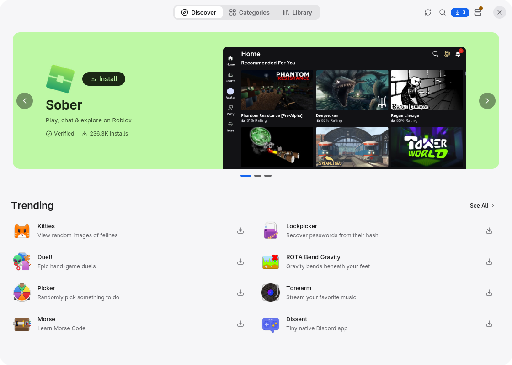
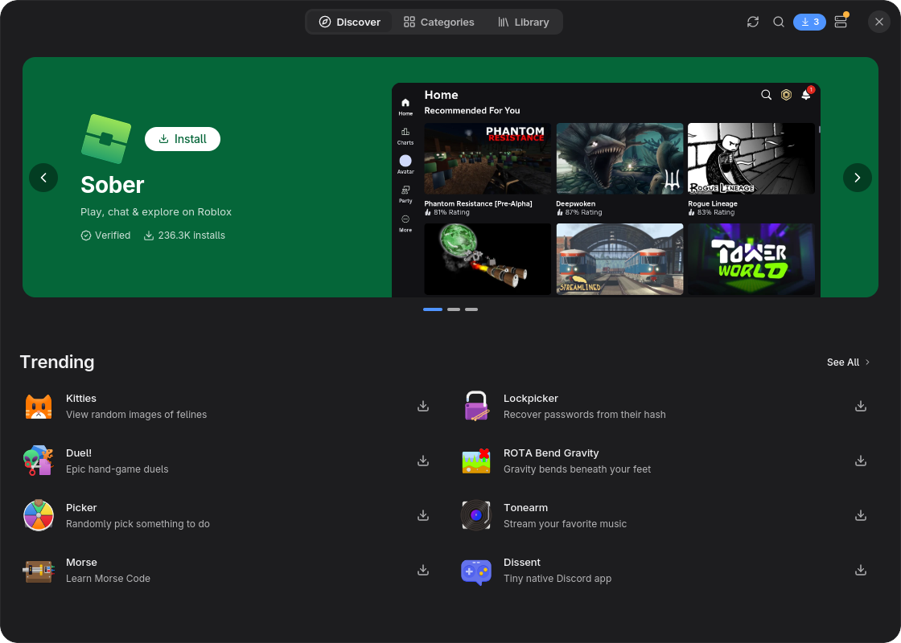
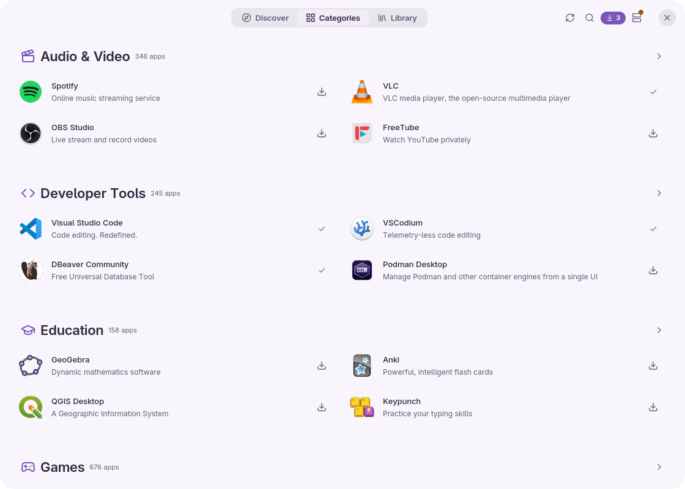
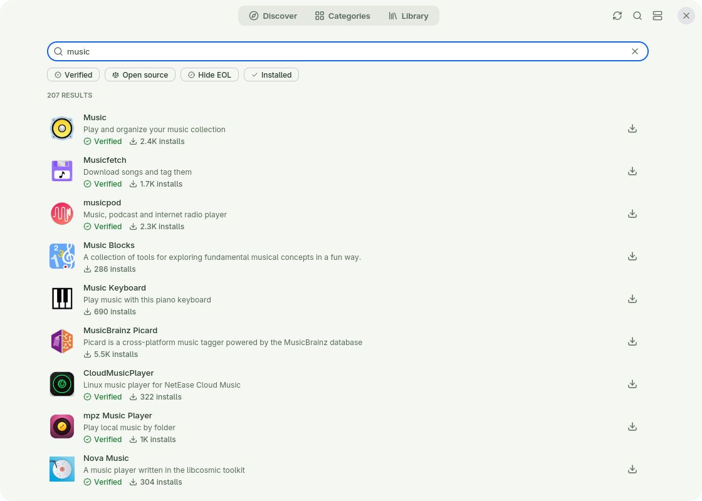
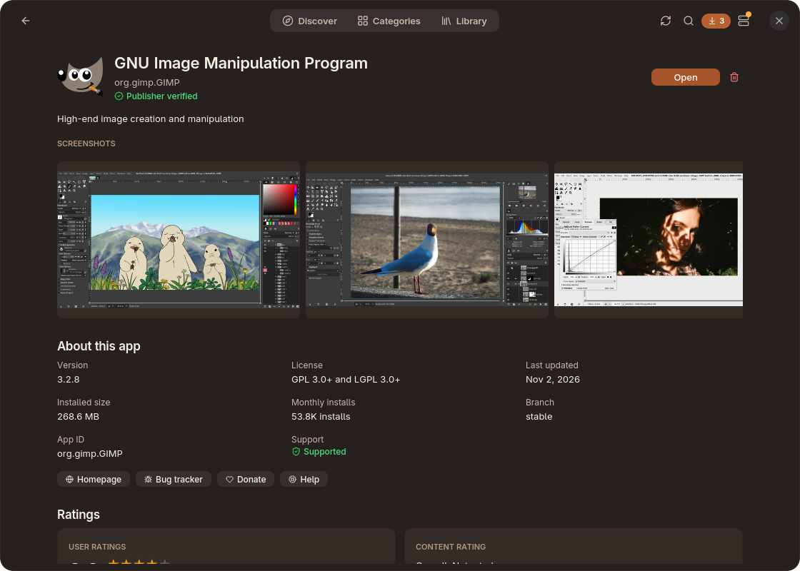
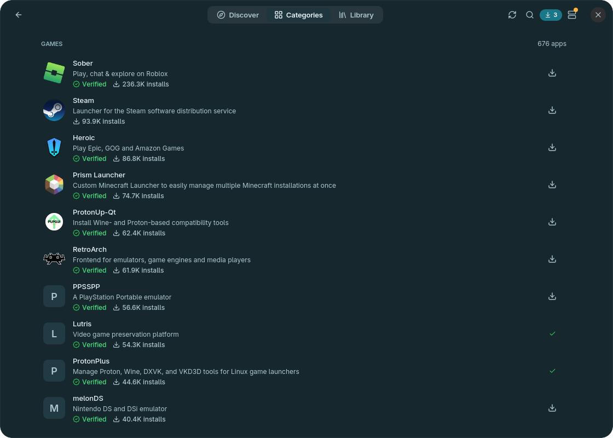
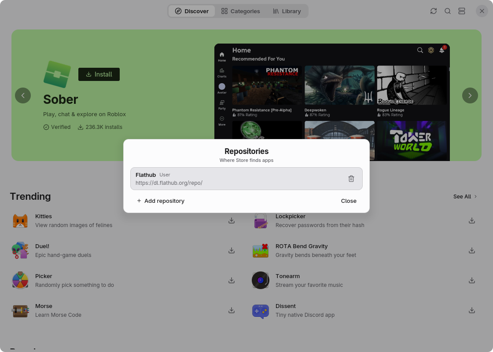
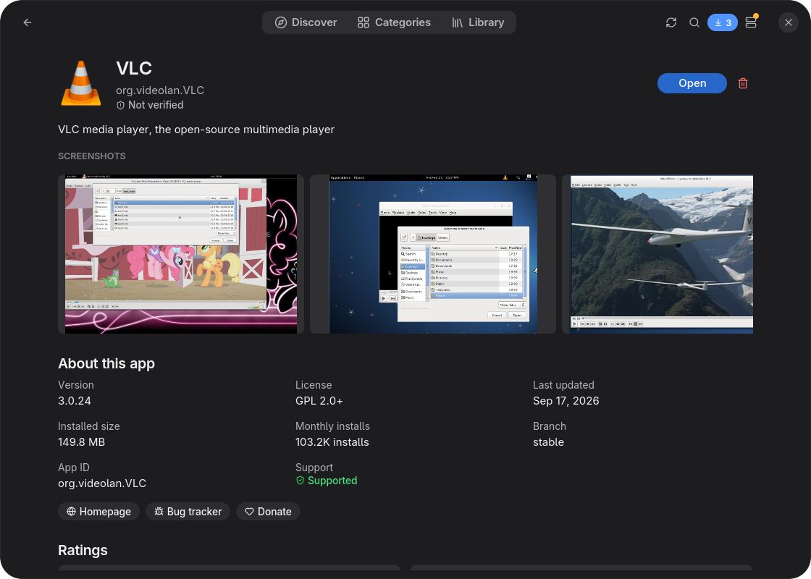

# Store

Discover, install and update desktop applications from your Flatpak repositories. Built with [enzUI](https://github.com/enz1m/enzui).

<table>
  <tr>
    <td align="center"><a href="docs/screenshots/basic-light.png"></a><br><sub>Discover · light</sub></td>
    <td align="center"><a href="docs/screenshots/basic-dark.png"></a><br><sub>Discover · dark</sub></td>
    <td align="center"><a href="docs/screenshots/lavender.png"></a><br><sub>Categories</sub></td>
    <td align="center"><a href="docs/screenshots/sage.png"></a><br><sub>Search</sub></td>
  </tr>
  <tr>
    <td align="center"><a href="docs/screenshots/ember.png"></a><br><sub>App details</sub></td>
    <td align="center"><a href="docs/screenshots/lagoon.png"></a><br><sub>Games</sub></td>
    <td align="center"><a href="docs/screenshots/precision.png"></a><br><sub>Repositories</sub></td>
    <td align="center"><a href="docs/screenshots/comfort.png"></a><br><sub>VLC details</sub></td>
  </tr>
</table>

Click a screenshot to enlarge. Images use isolated example data and shared enzUI themes.

## Features

- Featured applications, categories, search and app details from Flathub.
- Install and manage applications from configured Flatpak repositories.
- User-scoped installs, updates and operation history.
- Permission review, repository management and cached offline browsing.

## Build and run

Use Rust **1.99.1** (minimum **1.95**), a C/C++ toolchain and pkg-config.
Linux UI builds need Wayland/XKB, GLib/GIO, fontconfig and Vulkan/EGL development support.
Install Flatpak for catalog/install operations. No host packages are installed by the build.

```sh
cargo build --locked
cargo run --locked
```

Dependencies pin a public [enzUI](https://github.com/enz1m/enzui) revision and
its matching public foundation forks. No sibling framework checkout is needed.
Wayland is enabled by default; use `--features x11` when X11 support is needed.
Use `cargo build --release --locked` for an optimized binary.

## Files and desktop integration

Store is a catalog application and does not claim general document types. Installation remains an explicit reviewed action.

## Requirements and limits

Catalog browsing needs configured Flatpak remotes and network access; cached data
remains available offline. On enzimOS, installation and update requests use the
permission-review service when available. On other systems Store uses Flatpak's
direct user-installation path. Store does not provision the enzimOS service.

Installations are explicit user actions. Opening Store or its screenshots installs
nothing. System repositories remain host-managed; read-only operations are
identified in the interface instead of being silently redirected to user scope.

Shared enzUI theme settings apply live. Translations are under `assets/locales`;
locale coverage varies.

## Development

```sh
cargo fmt --all -- --check
ICED_TEST_BACKEND=software cargo test --locked --all-targets -- --test-threads=1
cargo clippy --locked --all-targets -- -D warnings
```

Keep tests for durable workflows, data integrity, resource ownership and security
boundaries. See [contributing](CONTRIBUTING.md).

Licensed under [MIT](LICENSE); retained dependency notices and licenses apply to
third-party code and assets.
